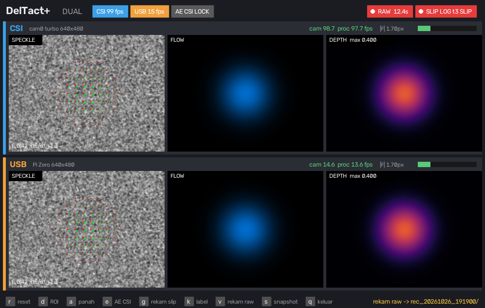

# Tactile UVC Sensor

Vision-based tactile sensor (DelTact-style dense colour pattern) whose CSI camera is turned
into a **plug-and-play USB webcam** by a Raspberry Pi Zero W. The host computes optical
flow, depth (mm), contact, force/shear/twist, slip and texture detail, shows them live and
can publish them on **ROS 2**.

Runs natively on two kinds of host:

| Host | OS | Setup |
|---|---|---|
| Raspberry Pi 5 | Raspberry Pi OS (Bookworm/Trixie, 64-bit) | `bash install/setup_raspi.sh` |
| PC / laptop / Pi 5 | Ubuntu 22.04 or 24.04 (x86-64 or arm64) | `bash install/setup_ubuntu.sh [--ros]` |
| NVIDIA Jetson Orin | JetPack 6 (Ubuntu 22.04) | `bash install/setup_ubuntu.sh` (+ CuPy for `gpu`) |

The camera is a standard UVC device, so no driver is installed on either host.



## How it works

```
IMX219 200° ─CSI─▶ Pi Zero W ─USB 2.0 (UVC, 640×480 YUYV, 15 fps)─▶ host (Pi 5 / Ubuntu)
                   libcamera → uvc-gadget → dwc2 + configfs UVC        uvcvideo → OpenCV
```

Host pipeline per camera:
undistort ROI → DIS optical flow (single or **adaptive/chained reference**) → Gaussian
density → guided filter → depth → depth-to-mm calibration → contact / force / shear /
twist / slip features → (optional) ROS 2 topics. A contact-aware **adaptive referencing**
re-takes the reference only when the gel is still, never while something is touched.

## Repository layout

```
host/                     runs on the host
  run_sensor_fast.py      one camera (USB, or CSI on a Pi 5) — main program
  run_sensor_dual.py      two cameras in one window (camera1 + camera2)
  run_sensor_calib.py     calibration / patent-measurement version: raw bursts with
                          per-frame metadata, noise-floor test, no-contact probe (Table IV),
                          checkerboard 'full' profile (CSI). Also runs on USB (Pi/Ubuntu)
  deltact_plus.py         sensing engine: undistort, DIS flow, adaptive tracking, depth
  adaptive_ref.py         contact-aware automatic re-referencing
  tactile_ros.py          contact/force/shear/twist/slip features + ROS 2 publisher
  tactile_listener.py     example ROS 2 node (grasp logic using the topics)
  record_dual.py          raw frame recording of both cameras
  mts_calib.py            depth → mm calibration from an MTS run
  make_synth_calib.py     synthetic calibration (testing only, NOT for publication)
  preview_uvc.py, test_fps.py, bench_flow.py   camera / speed tests
  calib/                  depth_calib_<camera>.json (one per sensor, created by 'o' / mts_calib)
zero/                     runs on each Pi Zero W
  setup_uvc_zero.sh       builds uvc-gadget + libcamera bits, installs the UVC gadget service
  tune_zero.sh            steady 15 fps: fixed 1 GHz, uvc-gadget priority, BT/timers off (--undo)
  rpi-uvc-gadget.sh       configfs UVC gadget (formats, frame rates, serial, name)
install/                  host setup scripts (Raspberry Pi OS / Ubuntu)
run.sh                    starts a host script with the right Python (venv on Ubuntu)
```

> **Needed from the lab machine:** `host/dt3_slip.py` (slip features, required),
> `host/nocontact_probe.py` and `host/sensor_share.py` (+ `view_3d_live.py`) are optional.
> Copy them into `host/` and commit. Without the optional ones the program still runs
> (no-contact probe and shared-memory 3D viewer are disabled).

## 1. Pi Zero W camera module

Flash Raspberry Pi OS Lite (32-bit) with Raspberry Pi Imager. The **hostname becomes the
camera name** (e.g. `camera1`, `camera2`). Then on the Zero:

```bash
sudo bash zero/setup_uvc_zero.sh      # builds and installs, enables the service
sudo reboot
```

**Steady 15 fps** (optional, per Zero, reversible): keeps the CPU at its normal 1 GHz
(no overclock), gives uvc-gadget CPU priority, switches off Bluetooth and background timers.
```bash
sudo bash zero/tune_zero.sh && sudo reboot     # undo: sudo bash zero/tune_zero.sh --undo
```

Each Zero appears on the host as `/dev/v4l/by-id/usb-<hostname>_Tactile_UVC_Cam_<serial>-video-index0`.
Use the Zero's **USB** (data) port. Offered formats: YUYV 640×480 @ 15/10 fps (used),
384×288, 320×256, MJPEG 640×480. A Zero W tops out at ~15 fps (single ARMv6 core).

## 2. Host setup

**Raspberry Pi 5 (Raspberry Pi OS)**
```bash
bash install/setup_raspi.sh --usb-power   # --usb-power: 1.6 A on USB for the Zero(s), reboot after
```

**Ubuntu 22.04 / 24.04**
```bash
bash install/setup_ubuntu.sh              # creates .venv with OpenCV contrib
bash install/setup_ubuntu.sh --ros        # + ROS 2 Humble (22.04) / Jazzy (24.04)
```
Log out and in once (video group). Check the cameras: `ls /dev/v4l/by-id/ | grep Tactile`.

## 3. Run

```bash
./run.sh usb                                        # one camera (first Zero found)
./run.sh usb --usb=camera2                          # pick a Zero by hostname
./run.sh dual --usb=camera1 --usb2=camera2          # two cameras, one window
./run.sh dual --usb=camera1 --usb2=camera2 prof     # + ms per stage every 3 s
./run.sh usb clean                                  # start from neutral settings
./run.sh usb track=adaptive                         # adaptive (chained) reference tracking
./run.sh usb detail                                 # + texture detail panel
./run.sh dual --usb=camera1 --usb2=camera2 gpu      # Jetson: depth on the GPU (CuPy)
source /opt/ros/jazzy/setup.bash && ./run.sh dual --usb=camera1 --usb2=camera2 ros --gel-mm=20
./run.sh --script=run_sensor_calib.py usb           # calibration tool (USB; CSI: 'full' on a Pi 5)
./run.sh --script=preview_uvc.py                    # quick camera check
./run.sh --script=test_fps.py camera1               # frame-rate test
```
Quit with **q** (not Ctrl+C). First: adjust `roi_thresh` until the gel area fits, press
**d**, release everything, press **r**.

### Keys

| Key | Action |
|---|---|
| `r` / `d` | new baseline (no contact) / re-detect ROI |
| `u` | clean controls (deadzone, EMA, tavg, rebaseline off) |
| `c` | save config (`host/sensor_config.json`) |
| `t` | tracking single ↔ adaptive (DelTact paper flow chaining) |
| `w` | adaptive referencing on/off |
| `f` | depth refinement on/off (default off = calibrated raw depth) |
| `x` | texture detail panel: off → fine → residual → depth |
| `a` | flow arrows |
| `g` / `k` | slip-feature log / label |
| `v` / `s` | raw recording / snapshot |
| `p` `z` `o` `l` | depth calibration: point, undo, fit & save, per-frame log |
| `q` | quit |

## 4. ROS 2 topics (`ros`)

Per camera under `/tactile/<camera>/`:

| Topic | Type | Content |
|---|---|---|
| `contact` | `std_msgs/Bool` | touching |
| `wrench` | `geometry_msgs/WrenchStamped` | force.z = normal load (N with `--force-gain`, else indentation volume), force.x/y = shear, torque.z = twist |
| `contact_point` | `geometry_msgs/PointStamped` | contact centre (mm with `--gel-mm`), z = max depth mm |
| `slip` | `std_msgs/Bool` | slipping |
| `event` | `std_msgs/String` | `touch`, `release`, `slip_start`, `slip_end` |
| `state` | `std_msgs/Float32MultiArray` | all features in one message |
| `depth` | `sensor_msgs/Image` (32FC1, mm) | depth map, 5 Hz |

Example consumer: `python3 host/tactile_listener.py camera1 camera2`.

## 5. Depth calibration (per sensor)

Press `l` to log depth while the MTS runs, then
`python3 host/mts_calib.py host/calib/logs/depthlog_<camera>_*.csv <mts files> --out=host/calib/depth_calib_<camera>.json`.
The file is loaded automatically for that camera. Until then a built-in **synthetic**
calibration is used (approximate; not for publication).

### Calibration tool (`run_sensor_calib.py`)

Keys: `s` raw frame + ROI + `meta.json`, `b` burst of 10 raw frames after the camera has
settled, `n` noise-floor test, `u` measurement mode, `m` no-contact recording.
On a **CSI** camera (Pi 5 + Picamera2) `u` also locks exposure/gain/AWB at a fixed operating
point. On **USB** (Pi Zero) the exposure is set on the Zero and cannot be locked: `u` only
cleans the controls, and `meta.json` records `camera_lock: false`.

## Troubleshooting

- **Green / glitchy frames**: the kernel driver is passing incomplete frames on (`cat /sys/module/uvcvideo/parameters/nodrop` shows 1). The setup scripts set `nodrop=0`; by hand: `echo 0 | sudo tee /sys/module/uvcvideo/parameters/nodrop`.

- **Camera freezes / disconnects, fps drops**: the Zero is short of power. Use a powered
  USB hub, or power the Zero's PWR port separately (Pi 5: `--usb-power`).
- **Flow and depth disagree**: run `./run.sh usb clean`, then `u`, `r`, `c`.
- **Noise left after a press**: adaptive referencing waits until the gel is still
  (`--aref-still=1.5` for slow gels); check the `[AREF]` lines in the terminal.
- **Dual: `proc` fps below `cam` fps**: each camera runs in its own process by default (Python threads block each other). `threads` selects the old single-process mode; `prof` shows where the time goes.
- **~15 fps maximum**: limit of the Pi Zero W; a Pi Zero 2 W runs the same firmware faster.
